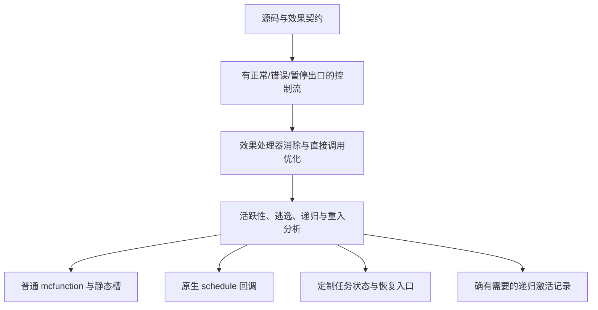

# MCFPP：无栈回溯依赖的效果与跨 tick 任务设计

日期：2026-10-07。状态：详细设计草案，未实现；示例中的新语法和 API 均为提案。

同日扩展：[异常、跨 tick 与 lambda 的统一设计](exceptions-tasks-lambdas-design.md) 纳入讨论 #33 的语法、闭包捕获与生命周期，并提出首版 finally 不允许错误逃逸的简化建议；该点与本文的覆盖规则属于待决策的替代方案。

本版依据用户的新约束重新确定后端：mcfunction 不提供可供语言使用的调用栈回溯、捕获或跨 tick 恢复机制；当前 NBT 模拟调用栈是待优化的兼容实现。跨 tick API 优先服务**全局定时任务与世界逻辑**。

本文取代 [原异常草案](exception-effects-design.md) 第 8、9 节将帧内异常协议作为统一实现的建议。[旧命令示例](exception-effects-examples.md) 的栈版本仅保留为原型说明。错误类型、自动传播、入口检查等语言规则继续有效。

## 1. 架构决定

采用：**静态效果检查 + 显式控制流出口 + 按需生成的任务状态机 + 分层存储分配**。

1. 普通函数维持直接调用，只有不能消除的递归或重入需要保存独立激活状态。
2. 异常是控制流上的错误出口，不能要求“搜索、展开或恢复 Minecraft 调用栈”。
3. 暂停是编译器提前切好的恢复入口，跨 tick 只保存之后仍需要的数据。
4. 同一个任务内的顺序子调用优先融合，不为每个 await 构造子任务对象。
5. 简单全局定时回调直接使用原生 schedule；复杂任务才链接任务调度组件。
6. 效果处理器优先在编译期确定；不为所有函数携带运行时处理器字典。
7. 单次恢复是基础约束；多次恢复不进入首版，也不隐式复制世界状态。

原生 function 调用能嵌套执行，并不等于提供了可捕获的语言调用栈。`return` 结束相应 Minecraft 函数，不能直接跳过任意层调用者、执行所有语言清理或把调用链保存到下个 tick。



## 2. 零成本抽象的可检查含义

目标是：**在语义相同、目标版本相同的前提下，抽象消除后的代码不承担其未使用能力的通用运行时成本**。比较对象是完成同一件事的合理手写 mcfunction。

这不意味着等待不需要调度、保存运行时数据不需要存储，也不承诺编译器总能找到全局最短命令序列。不能把省略并发隔离、取消、重复启动或 reload 语义的手写代码当作对照。

| 程序形态 | 要消除的抽象成本 | 允许存在的实际工作 |
| --- | --- | --- |
| 无异常、无暂停的直接函数 | 效果字典、异常标志、统一压栈/退栈 | 参数、结果和必要的普通调用 |
| 本地捕获且错误载荷不用 | 错误对象、异常搜索、传播协议 | 等价条件分支 |
| 单一无捕获定时回调 | TaskRecord、pc、每 tick 轮询、通用分派 | 一条原生 schedule 与回调本体 |
| 单实例多阶段任务 | 每次函数调用的帧、Promise 链、通用任务表 | 必要阶段入口和跨暂停活跃值 |
| 独立并发实例 | 为实例内每次普通调用分配对象 | 各实例独立状态、必要排队和唤醒 |
| 尾递归任务 | 无界返回历史 | 循环/状态转移及活跃循环变量 |
| 非尾递归且返回后仍需旧值 | 无法凭空消除的信息 | 必要激活记录，或显式限制该程序 |

对于无法满足成本约束的程序，编译器应指出原因；不得把昂贵通用路径标为零成本。

## 3. 当前源码的迁移起点

| 当前位置 | 观察到的实现 | 新设计要求 |
| --- | --- | --- |
| `analysis/TypedIR.kt` | Call 是普通指令，终结符没有错误/暂停出口 | 在逻辑 IR 中加入多出口与恢复入口，不嵌入物理帧路径 |
| `analysis/EffectAnalysis.kt` | 分析外部写入及未知内存效果 | 保留；异常、暂停、重入作为独立维度 |
| `analysis/PrimitiveCompiler.kt:1430` | 形参捕获、较广泛的寄存器保存、stackIn/stackOut | 在布局决定后生成调用，先分析真正跨调用活跃及受覆盖的值 |
| `model/function/NoStackFunction.kt` | 辅助函数共享父函数作用域/返回槽 | 可作已有工具，不能据名称认为已解决所有无栈调用问题 |
| `command/Commands.kt` | stackIn/out 操作 NBT 列表头 | 保留为 LegacyFrame 后端的一种实现，不进入语言语义 |
| `Project.kt:727` 附近 | 通过 parent 关系发现入口，并统一加入栈操作 | 建立显式入口清单，按 ABI 决定是否需要初始化/收尾 |
| `command/TargetCapabilities.kt` | 已有 return run、宏等能力表 | 增补调度、时钟、回调上下文与任务后端能力测试 |
| `mni/minecraft/StdCommands.java` | schedule 位置仍是 TODO | 不能依靠尚未实现的标准库调度契约 |

本轮不改动这些生产文件。原始命令和未知原生调用可能触发间接 function 调用，分析中必须考虑重入；只标记“写入未知”不足以证明静态临时槽安全。

## 4. 效果模型：检查契约与选择后端分开

示意签名：

```text
FunctionSummary {
    memory       // 现有位置写入、读世界、未知屏障等摘要
    raises       // 闭合错误集合或明确的 Error 上界
    maySuspend   // 是否可能把当前计算留到后续调度
    mayReenter   // 是否可能在返回前再次进入当前分配区域
    operations   // 尚未由静态处理器消除的用户效果要求
}
```

`raises`、`maySuspend`、`mayReenter` 不能由 `memory == Pure` 推出。一个不写外部位置的函数仍可能失败、暂停或调用回调。

`throws()` 继续只约束语言错误，不表示不会暂停。普通 `func` 的实际执行不能带着未处理的暂停效果；`task func` 允许暂停。构造任务计划本身不执行任务主体。

效果集合沿调用图求不动点。高阶函数的效果变量由实际回调绑定；类型参数与效果参数属于不同的编译器实体。效果参数无需成为可放入普通变量的 `type` 值。

公开签名的声明上界在跨库检查时稳定；取得函数体后的优化可细化实际出口，但必须维持公开 ABI，或在链接时成套重编译调用双方。

任务计划携带潜在效果，可记作 `Task<T, ε>`，ε 是编译期效果参数。构造计划只传播实参求值的效果；`await plan` 才将计划主体的错误与暂停效果引入当前位置。`launch(plan)` 不把未来错误伪装成登记函数当前抛出的错误，而是在根任务边界验证已提供处理方式。任务函数声明上的 throws 约束主体的潜在错误，不能在构造冷计划时就执行或抛出它们。

## 5. 开发者 API：先区分定时回调与顺序任务

### 5.1 简单全局定时器

```mcfpp
func announce() {
    /say The world event begins
}

func maintenance() {
    /say Maintenance
}

func configure() {
    timers.after("world.announcement", 200, announce);
    timers.every("world.maintenance", 1200, maintenance);
}
```

这里 `announce`、`maintenance` 是函数引用，不带括号，不会在登记时执行。函数引用语法和类型支持属于待实现部分。

| API | 精确定义 |
| --- | --- |
| `timers.after(key, ticks, callback)` | 全局键对应一个定时器；重复登记替换其尚未执行的触发，新的时长从本次调用计算 |
| `timers.every(key, ticks, callback)` | 首次在 ticks 后触发；每次实际触发后再等待 ticks；不追赶补执行错过的次数 |
| `timers.cancel(key)` | 删除该键后续触发；不逆转已经执行的回调 |

key 首版要求编译期字符串并按模块规范化，避免无意跨库冲突。同一个键的类型、回调族及生命周期策略须一致。动态键走将来的显式动态任务 API。

回调必须不暂停并返回 void。可失败回调要求显式 `onError` 处理器；默认的周期错误策略为 stop，continue 必须在登记时明确指定。错误处理器不暂停且不能再次向外抛出。无错误回调不生成这层错误处理。

同名键“替换”是 API 的可观察语义，因此可以使用原生 replace。需要每次登记都产生独立实例时，用 `tasks.launch`，不能偷换为按键去重。

### 5.2 顺序跨 tick 任务

```mcfpp
task func worldEvent() {
    /say Preparing
    await ticks(100);
    /say Started
    await ticks(600);
    /say Finished
}

func startEvent() {
    tasks.replace("world.event", worldEvent());
}
```

`worldEvent()` 构造冷任务计划：计算并捕获实参，但不执行主体。计划包含编译器已知的入口和捕获值；直接被 await/launch/replace 消费时应消除计划对象。

任务计划首版为单次消费的值；未消费的临时值给诊断，不能因复制计划而隐式启动两份任务。普通开发者通常不需要显式写出其类型。

| API | 精确定义 |
| --- | --- |
| `await ticks(n)` | 挂起当前任务，最早在 n 个游戏 tick 后恢复；0 等价于下一 tick；负数或超出目标范围报 InvalidDelay |
| `await otherTask(args)` | 顺序执行子计算；可以融合到当前任务，不要求分配独立任务实例 |
| `tasks.launch(plan)` | 创建独立全局根任务；最早在下一游戏 tick 开始执行，重复调用创建独立实例 |
| `tasks.replace(key, plan)` | 请求取消旧实例，完成其清理后启动最新计划；重复请求以最新计划为准 |
| `tasks.cancel(key)` | 请求取消，不承诺调用返回时清理已经执行完毕 |
| `await events.next(channel)` | 等待在登记后发出的下一条匹配事件；无默认每 tick 条件轮询 |

常量合法时长的检查应在编译期消除。动态时长的失败发生在实际登记/等待表达式处，进入普通 `raises` 分析，不能把负数默默解释为超长延迟。

timers 的时长采用相同规则：0 归一为下一 tick，every 的周期也至少为一个 tick；原生后端不能直接发出目标不接受的 0t。timers 登记时验证时长，任务中的 ticks 等待则在执行到该表达式时验证。

根任务的结果默认为 void，错误集合必须为空，或调用者显式提供 `onError`。失败处理器只处理任务主体与清理中真正产生的语言错误；正常取消是独立终态。

### 5.3 并发与结果，只在需要时引入

高级 API 提供结构化 `taskScope`、`scope.spawn(plan)`、`await handle` 和 `handle.cancel()`。spawn 产生独立实例，handle 的结果所有权不可被任意复制；首版只支持一个结果消费者。

scope 正常退出会等待子任务完成；异常或取消退出会取消并等待子任务清理。该语义包含暂停，所以 scope 只能位于 task 中。编译器不能为了消除 join 成本把未结束的子任务悄悄变成后台任务。

采用显式观察的错误规则：`await handle` 消费该子任务结果并在 await 处抛出其错误，允许就地捕获。未消费的错误在 scope 退出时统一观察；发现错误则取消并等待仍未完成的子任务，再传播所观察到的首个错误。多个当时已完成的错误按子任务登记顺序选择；已有主体错误优先，清理再次失败遵循 finally 覆盖规则。不把子任务失败变成可在父任务任意指令间注入的异步异常。

世界级后台工作优先用根任务 launch/replace；顺序工作用直接 await。普通 `await otherTask()` 不经由 spawn + handle + join 实现。

## 6. 时间、上下文与可观察顺序

时间单位为游戏 tick，不是现实时间，也不是可由 `/time set` 改变的昼夜刻度。服务器未推进相关游戏时间时，等待不承诺按现实秒数完成。

统一契约为“不早于指定 tick”；就绪任务在预算允许的后续调度阶段执行。同一 tick 的独立任务顺序默认不保证，不保证与其他数据包 tick 函数的相对顺序。需要顺序的逻辑写在同一任务内，或使用显式顺序队列。

这一规定使原生 schedule 和通用队列在允许的时序范围内可以互换。若未来提供精确阶段、FIFO 或优先级 API，这些承诺必须成为后端选择条件，不能仍无条件采用原生快捷路径。

全局任务在新的服务器调度上下文启动和恢复，不隐式保留启动处的 `@s`、位置、朝向或维度。默认空间上下文为目标版本的服务器调度默认值；世界逻辑宜使用显式维度与绝对位置。

显式 `world.at(dimension, position, body)` 可重新建立空间上下文。若跨暂停要求保存该上下文，其最小必要数据成为捕获。将来实体任务需要 EntityRef/UUID、失效策略与恢复上下文，作为可选层，不给全局任务添加实体扫描。

任务步骤运行到普通返回、抛出、显式暂停或取消检查点为止。不会为了预算在任意语句间隐式让出；这会改变世界修改的可观察顺序。需要分摊长循环时显式使用 `await ticks(0)` 或将来的带暂停效果的批处理 API。

## 7. 普通调用的分层存储策略

编译器先确定逻辑值和位置，再选择物理布局：

| 层 | 适用范围 | 存储与调用策略 |
| --- | --- | --- |
| S0：消除 | 常量、内联、已知效果处理器 | 无物理值或只剩必要命令 |
| S1：非重入直接调用 | 无递归、无活跃重入路径 | 静态命名槽；按跨过程活跃区间避免互相覆盖 |
| S2：固定实例区域 | 可证明同时最多一个实例的全局任务 | 固定 scoreboard/NBT 槽，只有跨暂停活跃数据长期保留 |
| S3：动态任务区域 | 多个任务实例同时存活 | 每个任务独立槽/记录，任务内部普通调用共享其区域 |
| S4：动态激活 | 非尾递归或不可消除的重入 | 只为必要的激活状态分配记录，可有上界或拒绝无界程序 |
| LegacyFrame | 尚未迁移的旧入口 | 通过桥接协议调用现有模拟栈，成本显式报告 |

S1 不能只靠“Minecraft 单线程”判断安全。普通调用 A→B 不会被下个 tick 抢占，但 B→回调→A 可以在同一条命令链中覆盖 A 的活跃槽。

需要构造函数/原生/回调调用图，分析递归 SCC、可达入口重入、未知原始命令，以及 callee 的寄存器覆盖集合。只保存交集 `LiveAcrossCall ∩ MayClobber(callee)`。生命周期不重叠且类型编码兼容的槽可以合并。

建立独立的命令/原生控制能力清单。已确认的 say 等命令可以证明不重入；任意未经分析的原始 function 调用不能自动获得这个证明。内存 Unknown 与控制 Unknown 分开保守处理，不因一个世界写命令就强迫整个程序分配调用帧。

受管理的异常/任务区域不允许无法建模的原始 return 或对编译器私有恢复入口的跳转绕过清理。此类操作必须由受控 intrinsic 表达，或给明确诊断；写入私有调度存储同样不能被认为保持任务协议。普通业务原始命令仍按其能力摘要生成。

普通独立根任务在不同步骤中可以复用同步 scratch；实际暂停前，所有跨暂停值必须已经存入所属任务区域。恢复入口不得把上次别的任务留下的 scratch 当作初始化值。

任意深度非尾递归仍需保存返回后要用的信息，这是算法的需求。允许采用专用递归记录，或在 strict stackless 模式报错。异常和普通定时器不能因此都被迫使用统一调用栈。`return run` 也不作为“任意递归在 Minecraft 内部一定常量栈空间”的保证。

## 8. 异常的无回溯实现

逻辑 IR 中每个可能失败的调用具有 `normal` 和 `error` 两个后继。处理器和 finally 在编译时变成目标块与清理边；运行时没有“找最近 catch”的栈搜索。

按以下顺序选择实现：

1. 本地 throw/catch：直接错误边；已知错误且载荷未用时消除载荷。
2. 内联/完全专门化区域：直接连接处理器；所有中间退出与清理路径均已显式化。
3. 保留调用边界：使用 Outcome ABI；返回后只在可能失败的调用处选择后继。
4. 未迁移函数：由 LegacyFrame 适配器实现同样的逻辑 Outcome，再返回新后端。

**不能**让被调用者简单 `function caller_catch` 后普通返回：调用者随后还可能继续执行正常路径。跨函数直接跳到处理器只允许在整个中间区域已转换为无遗留正常续句的控制流时使用。

现代目标的默认紧凑 Outcome ABI 可把 Minecraft 函数结果值专用于状态：0=成功，1=失败；普通语言返回值位于独立结果槽。错误类型已由契约唯一确定时无需运行时标签，否则使用稳定错误身份和载荷槽。命令 success 标志不是这个协议。

```mcfunction
# demo:check，参数已在 #input mcfpp.rt；只有一种无载荷错误
execute if score #input mcfpp.rt matches 1.. run return 0
return 1
```

```mcfunction
# 调用点；结果明确由协议返回，因此可用 execute store result
execute store result score #outcome mcfpp.rt run function demo:check
execute if score #outcome mcfpp.rt matches 1 run return run function demo:handled_error
say Accepted
return 0
```

这不是当前编译器实产。示例不分配 NBT 帧；采用静态槽的前提是已证明无活跃重入。`handled_error` 须结束在恰当的语言续块，此处假定它完成整个调用者的错误路径。

旧目标由目标能力适配器输出显式状态槽与受保护续块。实际调用不能混淆 ABI：外部原生函数未承诺状态返回时，必须使用明确适配器，不能直接解释其 Minecraft 返回数值。

static 参数的抛出前修改仍按语言规则写回；普通参数副本不写回。错误边上的流事实单独计算，不能复用正常返回的初始化/类型证明。

## 9. 跨 tick 编译：只有暂停边携带持久状态

新增逻辑终结符，名称为示意：

```text
Invoke(..., normal, error)
Raise(error, destination)
Suspend(reason, resumeEntry, exceptionalResume, cancellationEntry)
Finish(result)
CancelExit
```

编译流程：

```text
AST / 类型与效果约束
→ 带处理器作用域和清理边的 Typed CFG
→ 消除已知效果处理器、绑定可能调用目标
→ 区分普通 Call / Invoke / 暂停调用
→ 融合同任务的顺序 await 调用
→ 计算暂停活跃集和各阶段布局
→ 选择 S0..S4、NativeTimer 或通用任务后端
→ 输出入口、步骤、清理、唤醒和库元数据
```

一个暂停点需要保存的不是“当前函数的全部局部变量”，而是：

```text
Capture(s) = 在正常恢复/错误恢复/取消清理路径上仍活跃的值
             + 这些值不可重新定位的数据依赖
             + 仍活跃的动态处理器数据和资源状态
```

常量、静态函数身份、可由恢复入口推出的 pc、无副作用且值稳定的表达式都可以消除或重建。不能把 world 查询或可能变化的共享状态当作可安全重算的表达式。

例如 await 前读取世界分数为 local，await 后使用 local，必须保留当时的快照；再次读世界分数不是等价优化。相反，源码在 await 后才执行的读取，应观察恢复时的世界状态。

暂停后撤销关于可变外部状态的分析事实；独立局部快照的事实仍可保留。任何指向旧临时调用帧、临时数组元素视图或未稳定动态下标的引用不得逃到暂停之后。首版任务参数按值捕获；跨暂停的 static/ref 参数要求稳定 PersistentRef，否则拒绝。

顺序 `await child()` 的子函数不暂停时降为普通调用；有有限暂停结构且函数体可见时融合恢复子图。循环使用 pc 回边，不按迭代次数复制代码。递归等待若需要无界返回历史，则使用显式动态任务激活记录，strict stackless 模式拒绝该路径。

## 10. 零任务记录的原生定时快路径

对于 5.1 的单次无捕获回调，登记点只需：

```mcfunction
schedule function demo:timers/announcement 200t replace
```

回调：

```mcfunction
say The world event begins
```

没有 TaskRecord、pc、NBT 复制、轮询或每 tick 分派。回调身份本身已经表示“接下来执行什么”。完整程序另有生命周期初始化，其语义必须与手写对照一致。

快路径条件：静态 key、确定回调、固定无捕获环境或可证明唯一固定槽、无需独立实例计数/结果句柄、目标支持相应 schedule 功能。若要求独立任务、携带不同实参或严格顺序，则不能用一条 replace 假装满足。

每个 timer key 必须有独立的原生调度入口 ID。两个键即使引用同一个 callback，也不能因为函数体相同就合并预约入口，否则取消或替换一个键会影响另一个。入口内部的普通代码可以共享；链接器须保留调度身份。

周期回调可在运行用户回调前登记下一次触发：

```mcfunction
schedule function demo:timers/maintenance 1200t replace
say Maintenance
```

这样回调内部取消或替换该定时器时，能清除已经登记的下一次触发，不会在回调退出后被旧尾部代码重新登记。这个优化以回调不暂停为前提。若回调失败且策略为 stop，错误出口必须清除已登记的下一次触发。

原生 append 只用于能够证明语义的调度。独立实例与载荷不能仅凭 append 获得隔离；通用任务队列必须自行保留所有实例，不依赖同函数、同 tick 的原生调度是否合并。

## 11. 单实例任务：固定槽与分段函数

考虑以下任务，`readDifficulty` 和 `setReward` 为示意的同步世界操作：

```mcfpp
task func prepareReward() {
    var reward = readDifficulty() * 10;
    await ticks(200);
    setReward(reward);
}

func restartReward() {
    tasks.replace("world.reward", prepareReward());
}
```

假定没有清理、结果观察者和活跃重入，任务始终最多一份。可将唯一的 reward 保存到固定槽，并用回调身份编码阶段：

```mcfunction
# restartReward；取消旧阶段，再登记新起点，最早下一 tick 执行
schedule clear demo:reward/step1
schedule function demo:reward/step0 1t replace
```

```mcfunction
# demo:reward/step0
scoreboard players operation #reward.saved mcfpp.rt = #world.difficulty mcfpp.rt
scoreboard players operation #reward.saved mcfpp.rt *= #ten mcfpp.const
schedule function demo:reward/step1 200t replace
```

```mcfunction
# demo:reward/step1
scoreboard players operation #world.reward mcfpp.rt = #reward.saved mcfpp.rt
```

常量槽 #ten 在初始化中设为 10。MC 命令是手工目标展开，未执行。该例保存一个确实跨 tick 活跃的整数，没有保存临时运算寄存器，也没有通用 pc 字段。

它之所以无需 generation 检查，是原生回调可逐个清除、没有事件票据/结果观察者，且当前步骤不会重入替换自己。条件不满足时必须加入对应状态，不能将此展开泛化到任意任务。

有 cleanup 的任务被替换时，必须先执行旧 cleanup 再启动新计划；这个额外工作不能被上述简单 schedule clear 省掉。

## 12. 独立多实例：任务记录按程序形状生成

`tasks.launch(work(3))` 与 `tasks.launch(work(8))` 即使发生在同一 tick，也必须运行两次并分别保留数据。

逻辑记录示意：

```text
TaskInstance {
    identity: (session, slot, generation)
    state: Ready | Running | Waiting | Cleaning | terminal
    pc: ResumeEntry                 // 可由所属队列/函数身份消除
    waitVersion: integer            // 存在可迟到的唤醒才需要
    live: 按各恢复入口活跃集生成的字段
    outcome / waiter / context      // 只有被使用的能力才有
}
```

这不是每个实例强制拥有的通用大对象。按任务族生成布局：只有一个等待阶段时不存 pc；不需要 join 时不存成功结果；无取消清理时不存清理原因；普通全局任务不存 EntityRef；编译器已知错误类型不存重复标签。

多阶段字段可按非重叠生命周期共用槽；不同阶段的 record shape 可不同，但必须通过 pc 或队列身份唯一解码。

动态实例优先使用按任务族分组、按页分片的持久存储，避免把全部任务放在一个不断整体复制的大 NBT 列表里。计分板适合短小标量，NBT 适合结构数据。动态路径由目标宏能力或显式槽分派实现；不要宣称每次 NBT 子路径访问物理成本必定 O(1)。

任务句柄必须带 generation；槽复用之后，旧 handle 不得取消或恢复新任务。计数器溢出不能静默复用身份，应换 epoch 或在耗尽时诊断。一个任务先后等待两次时，还需要 waitVersion，防止第一次等待的迟到事件唤醒第二次。

## 13. 调度器：按需链接，空闲不轮询

全局运行时拆为独立组件：

| 组件 | 何时需要 |
| --- | --- |
| NativeTimer | 静态定时回调，只输出 schedule 和生命周期登记 |
| SingletonTask | 有跨阶段数据但实例唯一 |
| TaskPool + ReadyQueue | 真正的独立多实例或动态启动 |
| TimerQueue | 多实例共享唤醒、动态延迟或结果等待超时 |
| EventWaiters | 显式事件等待 |
| Join / Cancellation | 程序实际使用这些能力 |
| DurableWorkflow | 显式跨重载/重启的业务工作流，独立于普通任务 |

基础实现选择：就绪队列 + 定时最小堆/分组到期桶，原生 schedule 只负责唤醒最近的调度入口。没有任务时不注册持续 tick 轮询；只有事件等待时由事件触发，无须每 tick 扫描等待者。

登记更早的定时任务时重设调度入口；事件使任务就绪时保证下一 tick 有一次 drain。`schedule replace` 在这里替换的是“唤醒一次队列”的通知，不是队列里的任务实例。多个通知合并后仍应处理全部逻辑记录。

调度器记住下一次已安排的唤醒时刻：新唤醒不能把更早的已有唤醒推迟。反复使用 replace 安排 `1t` 而不维护这一不变量，可能使任务一直被延期。

每次 drain：

1. 收集已到期且身份仍有效的票据，移到当前就绪批次。
2. 冻结本批次处理范围；步骤中新增的工作进入后续批次。
3. 将实例从 Ready 改为 Running，再执行恢复入口。
4. 根据 Suspend/Finish/Raise/Cancel 路径更新状态并交接所有权。
5. 在“每次 drain 最多启动多少个步骤”的预算内继续；剩余工作安排到后续 tick。
6. 没有就绪任务时安排最近定时器；两者都没有则休眠。

普通任务步骤不直接递归调用另一个独立任务的恢复入口。事件回调只登记就绪票据，避免同步重入调度器。已经完成的顺序子计算或已完成 handle 可以立即提供结果；实际等待后的外部唤醒最早在后续 tick 执行。

最小堆比较/更新具有 O(log N) 的逻辑操作数，但命令数和 NBT 数据量必须实测；不能据此声称 Minecraft 总成本就是 O(log N)。初版可采用有明确规模上限的小池策略，但必须报告扫描成本，不把每 tick 全量扫描标为零成本。

取消要及时移除可定位的等待登记。若某后端采用惰性失效票据，取堆顶时先删除失效项，并设置有界压缩条件；不得在取消风暴中无限积累尚未到期的垃圾票据。根任务结束且无结果消费者时即释放实例，只有实际 join 的结果保留到消费者取得或所属 scope 结束。

### 13.1 时钟与回绕

通用队列使用后端 ClockAdapter，不直接拿一个不断增长的 32 位 scoreboard 当永久绝对时间。NativeTimer 快路径完全交给引擎计时。

ClockAdapter 的契约是单调游戏 tick 戳、可比较的 deadline、可验证的最大延迟和回绕行为。实现可使用经过目标测试确认的 `time query gametime` 周期读数与 epoch 扩展；不假定 `execute store ... long` 能把命令的整数结果变成完整 64 位游戏时间。

若原始读数周期为 M，必须在小于 M 的间隔采样以识别回绕，并限制未比较的时间跨度；必要时用原生 schedule 安排稀疏校准。时间戳用分段整数比较，deadline 加法避免有符号溢出。M 和目标延迟上限是待后端测试确认的能力字段，不能仅凭版本名猜测。

所有使用该时钟的任务在同一适配器内比较。load 时默认重置会话任务，不把上次会话的 clock/epoch 与新任务混用。队列空时无需维持时钟心跳。

## 14. 事件 API 与等待票据

`events.next(channel)` 订阅发生在执行到 await 的那一刻，只接收之后的匹配事件。默认不重放历史，也不进行实体轮询。

emit 按发出时有效的订阅集合产生票据；每个一次性订阅最多消费一条事件，发出时捕获所需事件数据。后来登记的订阅不接收旧事件。没有等待者的事件不默认留存；需要留存时显式使用有容量与溢出策略的 channel。

唤醒票据至少在语义上包含 `(session, slot, generation, waitVersion)`。消费前先检查匹配 Waiting，再切换到 Ready 并注销其他竞争来源。事件、超时、取消同时到来时，第一个合法状态转换获胜，其余票据失效。

单次恢复能力只能交给一个拥有者。订阅失败时必须立即释放/归还能力；取消订阅后迟到事件不能再次恢复。只有真正使用竞速等待时才需要这套额外登记字段。

## 15. 异常、取消与 finally 在状态机中的统一

编译时为每条退出边生成清理链，而不是运行时遍历帧。退出原因包括 Normal、Return(value)、Raise(error)、Cancel，以及离开作用域的 Break/Continue。

固定词法嵌套的清理链由代码位置确定，不生成动态 cleanup stack。只有条件获取资源等不能由 pc 推出的状态才保存活动标志。

```text
Step0 --await--> Waiting@Step1
Step1 --正常结束--> Cleanup(normal) --> Completed
Step1 --错误-----> Cleanup(error)  --> 外层处理器或 Failed
Waiting --取消--> Cleanup(cancel) --> Cancelled
```

暂停时不执行 finally；恢复后完成或取消时才执行。跨暂停的清理数据也属于活跃集，不能只分析正常续块而遗漏它们。

取消是协作式退出请求，不通过 catch(Error) 捕获。取消已停放的任务使其清理入口就绪；取消正在执行的步骤在其下一个退出/暂停检查点生效。没有可用的引擎机制去中途抢占一条任意 mcfunction 链。

同一实例先切到 Cleaning 再执行清理，完成后发布终态；重复取消不重复清理。清理抛出错误时，新错误成为失败原因，并继续尚未执行的外层清理。根任务的显式 onError 必须覆盖清理错误。

首版 finally 不允许暂停，也不允许跳出清理体的 return/break/continue；允许内部局部循环控制。异步清理、屏蔽取消和多次恢复另立扩展，避免第一版引入无限期 Cleaning 状态。

`tasks.replace` 是一个按 key 的替换屏障：旧任务完成清理之前新任务不运行；期间多次替换只保留最新待启动计划。只有证明旧任务无清理、无观察者且可清除全部唤醒时，才降为直接原生 replace/clear。

## 16. 代数效果：静态处理与单次暂停分别编译

先在核心中支持三类操作，而非给所有效果使用同一套 continuation 机制：

| 操作类 | 语义 | 首选编译方式 |
| --- | --- | --- |
| Direct | 处理器计算结果并立即返回给操作点 | 普通直接调用、内联或常量消除 |
| Abort | 放弃当前受处理计算，转到处理结果出口 | 显式错误/退出边；throw 是常见表面形式 |
| SuspendOnce | 保存剩余计算，之后最多恢复一次或取消 | 定制恢复入口 + 活跃环境 + 所有权票据 |

Direct 处理器必须在效果上不暂停，不能在实现里暗藏 SuspendOnce。一个效果可声明多种操作，但每个操作类别属于契约。源语言入门用户先使用 throw/try/catch、task/await；通用声明语法可以稍后稳定。

高级 API 语义示意，尚非确定的 parser 语法：

```text
effect Difficulty { direct read() -> int }
handler Easy for Difficulty { read() = 1 }
handle Easy { use(perform Difficulty.read()) }

effect Wait { suspendOnce ticks(n: int) -> void }
handler GameScheduler for Wait {
    ticks(n, continuation) = registerTimer(n, move continuation)
}
```

Easy 的静态处理器身份应完全消除；若 read 的语义可确定为 1，则不生成效果分派。GameScheduler 的 continuation 是“恢复入口 + 必要环境”的单次能力，绝不是 Minecraft 原生栈快照。

默认采用深处理语义：恢复后的计算仍处在原处理器作用域中。处理器实现自身执行在该层处理器之外，避免无意递归处理自己的同名操作。处理器正常结果、abort 结果、错误出口和清理出口必须在类型检查中统一。

静态 handler 捕获的数据按普通值活跃性处理；身份不需要存储。跨暂停后仍使用其运行时参数时，只捕获这些参数。第一版 continuation 不作为可任意复制的普通用户对象；只有受约束的调度适配器可持有并消费它。

SuspendOnce 的首版接口是单次所有权交接：登记成功后处理器结束当前步骤，整个受处理计算仍未完成；后续 resume/raise/cancel 消费该能力。登记失败必须回到错误出口，不能遗失能力。被恢复计算不会同步返回到已经结束的登记函数。

因此这是明确受限的代数效果核心，不声称已经支持任意单次控制处理器。如果将来允许处理器在 `resume(...)` 返回后继续执行自己的代码，那段处理器续体也要被类型化、保存并调度；不允许通过隐藏的 meta-stack 绕过成本约束。

处理器特化键采用函数身份、类型实参与处理器实现身份；不包含不断增长的动态调用历史。不按每个等待时长或 task id 克隆函数。递归变更处理器环境时需停止无限特化，给成本诊断或选择显式动态分派。

特化预算耗尽可使用有限 tag + 分派，但成本报告必须显示新增分派；strict zero-overhead 模式拒绝不满足约束的降级。尾恢复处理器无需捕获 continuation 的优化有现有语言研究支持，但其在 Minecraft 中的具体效果仍需实现验证，不能直接套用原生语言 benchmark。

## 17. reload、服务器重启与持久工作流

普通 timers/tasks 的默认生命周期为当前加载会话。load 初始化取消旧会话的调度、清除旧任务记录/票据，并建立新的 session。不能假定 NBT storage 在 reload 后自动消失。

生成产物保存本模块调度清单：原生 timer 回调、单实例步骤和通用 pump。更新时先消费上版清单清除旧调度，再安装新版清单；动态 clear 需要目标支持对应的宏适配。旧目标必须使用可验证的替代清理方案，否则拒绝该会话策略。

生成函数 ID 带布局/ABI 版本身份，避免旧预约误调用已经换了布局的新函数。加载成本也纳入报告，但不应给每个无捕获回调无条件增加 session 查询；能通过完整清理清单保证的地方可以消除该检查。

服务器停止、数据包被移除、引擎命令链强制截断，不保证运行 finally。持久世界资源应有显式恢复协议，例如业务阶段标记或带期限的占用记录，而不能只依赖内存式清理。

需要跨重启的世界事件使用单独 DurableWorkflow：保存稳定业务阶段名、schema 版本、业务数据与明确的时间策略。恢复先做版本迁移与校验，再启动新任务。禁止默认序列化任意编译器 pc、临时槽编号和 handler 实现地址，并承诺跨代码更新继续执行。

这是一项显式能力：需要它的任务承担检查点和恢复成本；普通定时回调不附带整套持久工作流运行时。

## 18. 库边界与 ABI

库元数据需要携带：效果契约、普通 ABI 版本、是否可能重入、错误布局、暂停函数的恢复图或可重编译 IR，以及可提供的 cost class。

理想情况是消费端取得模板化 IR，将普通 await 子调用融合进调用者任务。只有预编译命令的库无法凭空做到这种融合：它必须提供明确的 resumable adapter，否则不允许从可暂停区域假装普通调用。

物理布局选择独立于普通值 TypeId。函数的逻辑输入/输出不因 S1 静态槽或 S3 任务槽而变成两个语言类型。效果集合、处理器绑定和 ABI 版本进入合适的链接/特化身份，而非随意拼进类型显示名。

同一链接单元中私有函数可用最小布局，公开 ABI 保持稳定。不能单独升级被调用库的 status 约定却让旧调用者继续读取原成功返回值。

## 19. 可见的成本报告与硬约束

建议新增编译器成本报告，示意：

```text
announceTimer:
  lowering: NativeTimer
  task records: 0
  persistent captures: 0
  idle tick polling: 0
  registration: 1 schedule command

prepareReward:
  lowering: SingletonTask
  persistent captures: reward:int
  erased captures: temporary_product, constant_10
  call frames: 0
  resume entries: 2

parallelWorldJob:
  lowering: TaskPool
  reason: independent overlapping instances
  captures: regionId, remainingWork
  extra capabilities: cancellation ticket
```

硬约束可先以编译选项/属性表达，不急于增加一堆语言关键字：

- Stackless：禁止动态调用激活记录，违反时定位递归/重入来源。
- NativeTimerOnly：要求原生 schedule 快路径，捕获、并发或强时序承诺阻止时给诊断。
- MaxPersistentFields / MaxTaskInstances：约束已定义的逻辑成本；实例容量耗尽必须有明确可处理结果。

不要使用含义模糊的 NoAlloc 声称 schedule 没有任何引擎分配；约束应具体到“不生成 MCFPP TaskRecord”等可检查事实。

任务池容量限制是显式配置能力。无容量限制的普通 API 不凭空承诺能突破引擎资源限制；有界池的启动失败必须返回结果或声明 TaskCapacity 错误，不能丢弃新任务。

## 20. 实施顺序与验收

| 阶段 | 交付 | 放行条件 |
| --- | --- | --- |
| A：逻辑/物理解耦 | 出口 IR、入口清单、调用布局接口；LegacyFrame 适配 | 原有行为回归通过，不改变尚未迁移语言语义 |
| B：普通无栈路径与异常 | S1 分配、活跃保存、直接错误边、Outcome ABI | 非递归小程序无统一压栈；重入与 static 异常写回正确 |
| C：全局原生 timers | after/every/cancel、key 契约、生命周期清单 | 简单 after 与手写 schedule 等价；同键替换、周期自取消及 reload 正确 |
| D：单实例任务 | task/await ticks、活跃集、阶段融合、取消清理 | 固定槽跨 tick 正确；无每调用帧；世界快照不被重新读取替代 |
| E：多实例与事件 | TaskPool、队列、票据、时钟适配 | 重复同 tick 启动不丢实例；迟到事件、复用槽、超时/取消竞速正确 |
| F：库与效果扩展 | resumable IR 导出、效果多态、静态用户 handler | 跨库契约/成本可见；未支持路径无静默降级 |
| 独立后续 | DurableWorkflow、实体上下文、异步清理 | 各自明确状态持久化与版本迁移协议 |

不先实现一个万能 VM 再期待优化器消除它；先让常见全局场景确实输出与手写相同的结构，再加入需要运行时状态的能力。

必要验证矩阵：

1. 无异常普通调用、局部异常、深链异常：正确出口、无多余帧、无读取陈旧返回值。
2. 多个阶段中的局部值、外部世界值：仅保存活跃值，恢复后正确区分快照与新读取。
3. 同 tick 两次独立 launch 与同 key 两次 after：前者执行两份，后者只保留最新。
4. 同一实例两次等待、迟到事件、句柄复用：generation/waitVersion 拒绝错误恢复。
5. 周期回调内部取消/替换：旧代码不得重新登记被取消周期。
6. 正常、错误、取消、替换、嵌套 finally：应执行的清理恰好一次，暂停本身不清理。
7. 最早唤醒重设、零时长、负时长、队列预算、时钟回绕：不提前、不丢失、不因 replace 反复推迟。
8. 旧原生/未知 raw command/递归回调：静态槽不能覆盖活跃值，必要降级可见。
9. reload/重启/代码更新：旧票据失效、旧 schedule 清除、默认任务不误恢复。
10. 至少固定一个现代服务器目标做真实执行，再验证旧目标能力适配；模拟器结果不能替代调度相位与命令上下文测试。

成本测试同时记录：生成命令数、实际执行命令数、NBT 读写字节、持久标量/字段数、任务数、调度唤醒数、代码体积及服务器 MSPT。错误路径、成功路径、取消路径和 load 路径分别比较对应的手写基线。

首批硬指标：简单无捕获 after 的登记只增加一条 schedule；无活跃通用任务时无持续 tick 扫描；S1 普通函数没有统一 stackIn/out；静态 handler 无运行时 handler 查找；直接 await 子任务不分配独立 TaskHandle。

## 21. 依据与尚待验证的边界

- [Minecraft 1.15 官方发布说明](https://feedback.minecraft.net/hc/en-us/articles/360037384972-Minecraft-Java-Edition-Buzzy-Bees) 说明 schedule 的 append/replace/clear，以及 storage 跨 reload 保留。原生定时与加载清理据此分开设计。
- [Minecraft 1.20.3 官方发布说明](https://www.minecraft.net/en-us/article/minecraft-java-edition-1-20-3) 记录 return run 与结果/success 语义。Outcome 状态是 MCFPP 明确定义的返回协议，不将任意命令结果当异常。
- [Koka 官方处理器运行时文档](https://koka-lang.github.io/koka/doc/std_core_hnd.html) 区分尾恢复与一般控制操作，说明尾恢复可避免捕获 resumption。本提案借鉴按操作性质分别降级的原则。
- [Lexical Effect Handlers, Directly](https://cs.uwaterloo.ca/~yizhou/papers/lexa-oopsla2024.pdf) 为静态作用域处理器及优化提供研究背景；不构成 Minecraft 后端性能已被验证的证据。

目标版本的 ClockAdapter 周期、schedule 阶段/上下文、同 tick 重复预约与宏调用细节仍须通过官方代码/真实服务器测试固定为能力契约。本文没有声称这些新增后端已经实现或通过服务器测试。

## 附录：设计自检

本版已将旧统一模拟栈假设撤出核心，以用户选定的全局任务为主线。五项平均 4.0/5。

| 维度 | 评分 | 依据与进一步改进 |
| --- | --- | --- |
| 准确性 | 4/5 | 对照现有调用、入口及能力表，区分逻辑出口与物理存储；ClockAdapter 和实际调度相位仍需服务器验证 |
| 完整性 | 4/5 | 覆盖 API、存储、异常、暂停、并发、取消、重载与成本；高级 handler 的完整表面语法尚未固定 |
| 清晰度 | 4/5 | 常见 API 与底层分章，给出无帧命令例；通用队列与时钟章节需要读者有编译器背景 |
| 可操作性 | 4/5 | 有源码接入表、分期放行条件和可测硬指标；下一步应做 B/C 纵向原型以验证成本 |
| 简洁性 | 4/5 | API 入门保持 timers、task/await 两层；完整设计较长，后续语言手册应单独抽取入门页 |

优先改进：固定一个服务器目标验证原生 timers；验证跨过程活跃性与重入隔离；再测单实例任务的真实命令/存储成本。自检判断：可用于架构评审，不应把设计评分当成零成本已兑现的证明。没有评分不高于 2 的项。
